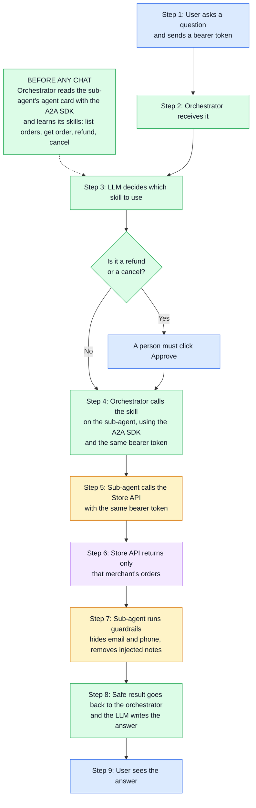
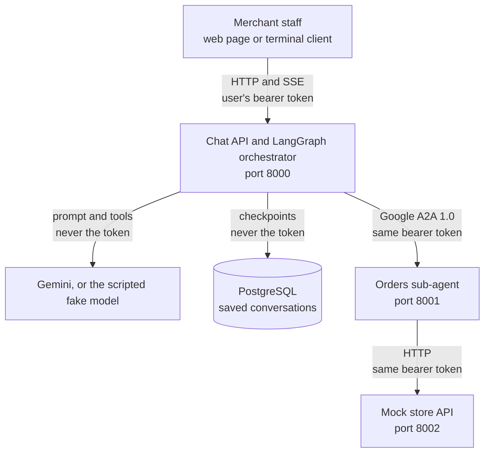
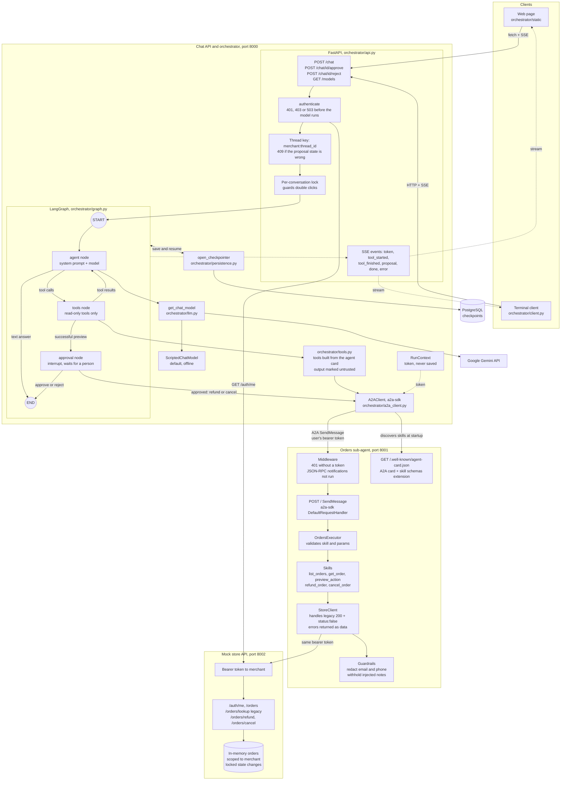

# Architecture

Trade-offs and reasoning are in [DESIGN.md](DESIGN.md).

## Minimal architecture

Colours: blue is the person, green is the orchestrator, yellow is the sub-agent, purple is the
store.

## Overall architecture

## Full architecture

Three rules the diagram shows:

- **Only the approval node can change an order.** The model's tools are read-only, and refunds
  and cancels run only after a person approves.
- **The bearer token is passed along and never stored.** It travels from the client to the store
  unchanged, and it is not given to the model or saved in PostgreSQL.
- **The store enforces tenancy.** Every order lookup and change is scoped to the token's merchant.
